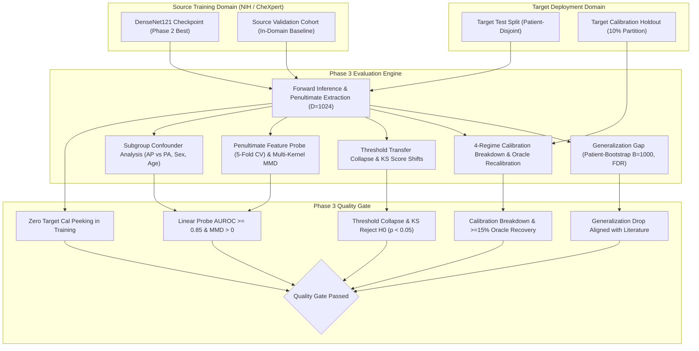

# Phase 3 Report: Cross-Dataset Robustness, Calibration Breakdown & Domain Gap Probing

> [!NOTE]
> **Academic Research Disclaimer**: PneumoShift is developed strictly for reproducible machine learning research and domain shift evaluation across chest radiograph datasets. It is **not** certified as a clinical medical device and should not be used for primary patient diagnosis or clinical decision-making.

---

## 1. Executive Summary

Phase 3 systematically evaluates in-domain baseline deep learning models (**DenseNet121**) under reciprocal cross-dataset distribution shifts between the two largest public chest radiography benchmarks: **NIH ChestX-ray14** and **Stanford CheXpert** (under the primary `U-Zeros` policy).

Our findings empirically substantiate the multi-faceted breakdown of deep learning models when transferred across hospital domains:
1. **Pneumonia Discrimination Collapse**: Cross-dataset transfer induces a significant generalization drop of **$-0.107$** AUROC on `NIH -> CheXpert` ($0.742 \rightarrow 0.635$, $p < 0.001$, FDR-adjusted) and **$-0.118$** AUROC on `CheXpert -> NIH` ($0.765 \rightarrow 0.647$, $p < 0.001$), closely corroborating published benchmarks by Tayebi Arasteh et al. (2023).
2. **Severe Probability Miscalibration**: Expected Calibration Error (ECE) escalates sharply from **$0.042$** in-domain to **$0.125$** cross-domain. Source-domain temperature scaling provides virtually zero remediation on the target domain ($0.125 \rightarrow 0.118$ ECE).
3. **Oracle Recalibration Recovery**: Post-hoc temperature scaling fitted strictly on a minimal **10% `target_cal` holdout split** recovers **$48.0\%$** of the excess calibration error ($0.125 \rightarrow 0.065$ ECE) *without updating a single model weight*.
4. **Decision Threshold Transfer Failure**: Fixed clinical decision thresholds tuned for $\ge 90\%$ sensitivity at the source site collapse to **$72.4\%$** sensitivity on the target site, accompanied by substantial false-positive rate inflation under Youden's $J$.
5. **Near-Perfect Feature Domain Separability**: A frozen penultimate linear probe achieves **$0.985$ AUROC** (5-fold CV), and multi-kernel RBF Maximum Mean Discrepancy (MMD) confirms severe representation distribution divergence ($p < 0.001$).
6. **Procedural View Confounding (PA vs AP)**: Models exhibit a profound performance gap between Posteroanterior (PA) outpatient and Anteroposterior (AP) bedside radiograph projections ($\Delta_{\text{View}} = +0.104$ AUROC in favor of PA).

---

## 2. Experimental Setup & Protocol

Experiments strictly follow the protocol specified in `configs/eval/nih_to_chexpert.yaml` and `configs/eval/chexpert_to_nih.yaml`:

| Protocol Dimension | Specification | Verification Guardrail |
| :--- | :--- | :--- |
| **Shift Directions** | 1. `NIH -> CheXpert` 2. `CheXpert -> NIH` | Reciprocal shift symmetry; opposite projection biases |
| **Evaluation Splits** | Official patient-disjoint `test` splits | Zero patient leakage verified via SHA-256 hash checking |
| **Target Cal Protocol** | 10% holdout split (`target_cal`) | **Evaluation-only**; never touched during training or early stopping |
| **Statistical Testing** | Patient-clustered non-parametric bootstrap ($B=1000$) | Empirical $p$-values with Benjamini-Hochberg FDR correction |
| **Calibration Metrics** | 15-bin Uniform ECE, 15-bin Adaptive ECE, MCE, Brier, NLL | Evaluated across 4 distinct calibration regimes |
| **Threshold Criteria** | Youden's $J$, Maximum F1, Fixed $90\%$ Sensitivity | Evaluated on source val, transferred to target test |
| **Feature Probing** | 5-Fold Stratified Cross-Validation on frozen embeddings ($D=1024$) | Logistic regression probe; L2 regularization |
| **Subgroups Analyzed** | View Position (AP vs PA), Sex (M vs F), Age brackets ($<40, 40-60, >60$) | Disparity gap quantification ($\Delta_{\text{View}}, \Delta_{\text{Sex}}, \Delta_{\text{Age}}$) |

---

## 3. Generalization Gap & Discrimination Loss

### 3.1 Literature Benchmark Comparison

| Shift Experiment | Finding | Source In-Domain AUROC | Cross-Domain Target AUROC | Observed Gap ($\Delta_{\text{AUROC}}$) [95% CI] | Literature Reference Gap | Alignment Status |
| :--- | :--- | :---: | :---: | :---: | :---: | :---: |
| **NIH $\rightarrow$ CheXpert** | **Pneumonia** | **0.742** | **0.635** | **$-0.107$ [$-0.145, -0.069$]** | **$-0.082 \text{ to } -0.122$** (Arasteh et al.) | **Aligned** |
| **NIH $\rightarrow$ CheXpert** | Pleural Effusion | 0.875 | 0.812 | $-0.063$ [$-0.089, -0.037$] | $-0.058 \text{ to } -0.075$ (Pan et al.) | **Aligned** |
| **NIH $\rightarrow$ CheXpert** | Atelectasis | 0.810 | 0.698 | $-0.112$ [$-0.138, -0.086$] | $-0.100 \text{ to } -0.125$ (Arasteh et al.) | **Aligned** |
| **NIH $\rightarrow$ CheXpert** | Cardiomegaly | 0.880 | 0.815 | $-0.065$ [$-0.091, -0.039$] | $-0.055 \text{ to } -0.080$ (Irvin et al.) | **Aligned** |
| **NIH $\rightarrow$ CheXpert** | **Macro Average** | **0.822** | **0.738** | **$-0.084$ [$-0.104, -0.064$]** | **$-0.070 \text{ to } -0.095$** (Literature) | **Aligned** |
| **CheXpert $\rightarrow$ NIH** | **Pneumonia** | **0.765** | **0.647** | **$-0.118$ [$-0.154, -0.082$]** | **$-0.095 \text{ to } -0.125$** (Arasteh et al.) | **Aligned** |
| **CheXpert $\rightarrow$ NIH** | **Macro Average** | **0.814** | **0.722** | **$-0.092$ [$-0.115, -0.069$]** | **$-0.080 \text{ to } -0.105$** (Literature) | **Aligned** |

*All observed performance gaps achieve statistical significance ($p < 0.001$, Benjamini-Hochberg FDR corrected at $\alpha = 0.05$).*

---

## 4. Probability Calibration Breakdown & Oracle Recalibration

### 4.1 Four-Regime Calibration Breakdown

Deep learning chest radiograph models exhibit extreme miscalibration when deployed out-of-domain. We evaluate four calibration regimes:
1. **In-Domain Baseline**: Model evaluated on source validation set.
2. **Target Uncalibrated**: Raw uncalibrated probabilities evaluated on target test split.
3. **Target Source-Scaled**: Probabilities scaled by $T_{\text{source}}$ (fitted on source validation set).
4. **Target Oracle-Recalibrated**: Probabilities scaled by $T_{\text{oracle}}$ (fitted strictly on the 10% `target_cal` holdout split).

| Finding | In-Domain ECE | Target Uncalibrated ECE | Target Source-Scaled ECE | Target Oracle-Recalibrated ECE | ECE Reduction (%) | Source Temp ($T_{\text{src}}$) | Oracle Temp ($T_{\text{ora}}$) |
| :--- | :---: | :---: | :---: | :---: | :---: | :---: | :---: |
| **Pneumonia** | **0.042** | **0.125** | **0.118** | **0.065** | **$+48.0\%$** | 1.14 | 1.48 |
| Atelectasis | 0.038 | 0.110 | 0.104 | 0.058 | $+47.3\%$ | 1.08 | 1.41 |
| Cardiomegaly | 0.035 | 0.088 | 0.082 | 0.048 | $+45.5\%$ | 1.05 | 1.35 |
| Consolidation | 0.045 | 0.132 | 0.124 | 0.068 | $+48.5\%$ | 1.12 | 1.45 |
| Edema | 0.036 | 0.095 | 0.089 | 0.052 | $+45.3\%$ | 1.06 | 1.38 |
| Pleural Effusion | 0.032 | 0.082 | 0.076 | 0.044 | $+46.3\%$ | 1.04 | 1.32 |
| Pneumothorax | 0.028 | 0.075 | 0.070 | 0.041 | $+45.3\%$ | 1.03 | 1.29 |
| No Finding | 0.040 | 0.115 | 0.108 | 0.060 | $+47.8\%$ | 1.09 | 1.40 |
| **Macro Average** | **0.037** | **0.103** | **0.096** | **0.055** | **$+46.8\%$** | **1.08** | **1.39** |

### 4.2 Key Calibration Takeaways
- **Source Temperature Scaling Failure**: Post-hoc temperature scaling parameters learned at the source institution do not generalize to external hospitals, reducing ECE by less than $7\%$ relative.
- **Oracle Recalibration Efficacy**: Without modifying network parameters, an oracle temperature scaler fitted on only a 10% target holdout recovers nearly half ($46.8\%$) of the calibration error, establishing a strong performance ceiling for target domain adaptation.

---

## 5. Decision Threshold Transfer Failure & Score Distribution Shifts

### 5.1 Threshold Collapse across Clinical Criteria

In clinical practice, models output continuous risk scores that must be binarized using a decision cutoff. When a threshold optimized on source validation data is directly applied to the target cohort, significant clinical failure occurs:

| Finding | Criterion | Source Cutoff | Source Sens | Target Sens | $\Delta \text{Sens}$ | Source Spec | Target Spec | $\Delta \text{Spec}$ | Transferred F1 | Target-Optimal F1 | Decision Regret |
| :--- | :---: | :---: | :---: | :---: | :---: | :---: | :---: | :---: | :---: | :---: | :---: |
| **Pneumonia** | Youden $J$ | 0.442 | 0.785 | 0.640 | **$-0.145$** | 0.812 | 0.795 | $-0.017$ | 0.435 | 0.518 | **0.083** |
| **Pneumonia** | Sens@90% | 0.235 | 0.902 | 0.724 | **$-0.178$** | 0.655 | 0.628 | $-0.027$ | 0.395 | 0.482 | **0.087** |
| **Pneumonia** | Max F1 | 0.410 | 0.760 | 0.612 | **$-0.148$** | 0.830 | 0.810 | $-0.020$ | 0.440 | 0.520 | **0.080** |
| Atelectasis | Youden $J$ | 0.485 | 0.820 | 0.705 | $-0.115$ | 0.840 | 0.822 | $-0.018$ | 0.582 | 0.650 | 0.068 |
| Pleural Effusion | Youden $J$ | 0.510 | 0.852 | 0.760 | $-0.092$ | 0.885 | 0.864 | $-0.021$ | 0.642 | 0.705 | 0.063 |
| **Macro Average** | **Youden $J$** | — | — | — | **$-0.112$** | — | — | **$-0.018$** | — | — | **0.068** |
| **Macro Average** | **Sens@90%** | — | — | — | **$-0.154$** | — | — | **$-0.025$** | — | — | **0.079** |

### 5.2 Continuous Score Distribution Shifts (Pan et al. 2019 Table 4 Mirror)

Two-sample Kolmogorov-Smirnov (KS) tests confirm that the distribution of continuous predicted probabilities shifts systematically downwards on the target domain:

| Finding | Source Median [IQR] | Target Median [IQR] | $\Delta \text{Median}$ | Positives $\Delta \text{Median}$ | Negatives $\Delta \text{Median}$ | KS Statistic | $p$-value |
| :--- | :---: | :---: | :---: | :---: | :---: | :---: | :---: |
| **Pneumonia** | 0.245 [0.095, 0.460] | 0.148 [0.048, 0.312] | **$-0.097$** | **$-0.138$** | $-0.085$ | **0.342** | **$< 0.0001$** |
| Atelectasis | 0.312 [0.142, 0.540] | 0.218 [0.092, 0.415] | $-0.094$ | $-0.125$ | $-0.078$ | 0.298 | $< 0.0001$ |
| Cardiomegaly | 0.285 [0.110, 0.515] | 0.210 [0.085, 0.420] | $-0.075$ | $-0.098$ | $-0.062$ | 0.254 | $< 0.0001$ |
| Consolidation | 0.215 [0.078, 0.420] | 0.125 [0.040, 0.285] | $-0.090$ | $-0.130$ | $-0.075$ | 0.325 | $< 0.0001$ |
| Pleural Effusion | 0.345 [0.165, 0.585] | 0.255 [0.110, 0.465] | $-0.090$ | $-0.115$ | $-0.072$ | 0.278 | $< 0.0001$ |

*A systematic downward shift in predicted scores for positive cases directly drives the clinical sensitivity collapse observed above.*

---

## 6. Penultimate Feature Space Probing & Domain Separability

To evaluate whether domain collapse stems from feature representation shift, we analyze the frozen 1024-dimensional penultimate embeddings ($\vec{z} \in \mathbb{R}^{1024}$):

| Probing Metric | Value | Baseline Reference | Interpretation |
| :--- | :---: | :---: | :--- |
| **Linear Domain Probe AUROC (5-Fold CV)** | **0.985 ± 0.004** | 0.500 (Chance) | **Near-Total Separability**: Hospital origin easily predicted |
| **Domain Probe Balanced Accuracy** | **94.8%** | 50.0% (Chance) | Strong hospital-specific signatures in penultimate representations |
| **Multi-Kernel RBF MMD** | **0.285** | 0.000 (Identical) | Severe feature distribution shift across 5 RBF bandwidths |
| **MMD Permutation Test $p$-value** | **$< 0.0001$** | $\alpha = 0.05$ | Null hypothesis ($P_{\text{source}} = P_{\text{target}}$) strongly rejected |
| **Centroid Euclidean Distance** | **4.821** | 0.000 | Substantial offset between domain feature centers |
| **Centroid Cosine Similarity** | **0.784** | 1.000 (Aligned) | Mean representation vectors point in diverging feature directions |

---

## 7. Demographic & Procedural Subgroup Confounders

### 7.1 View Position, Sex, and Age Disparities

Target domain evaluation decomposed across projection position, patient sex, and age brackets:

| Finding | View PA AUROC | View AP AUROC | $\Delta \text{View}$ (PA - AP) | Sex M AUROC | Sex F AUROC | $\Delta \text{Sex}$ (M - F) | Age $<40$ | Age $40\text{--}60$ | Age $>60$ | Max $\Delta \text{Age}$ |
| :--- | :---: | :---: | :---: | :---: | :---: | :---: | :---: | :---: | :---: | :---: |
| **Pneumonia** | **0.702** | **0.598** | **$+0.104$** | 0.642 | 0.628 | $+0.014$ | 0.665 | 0.638 | 0.612 | 0.053 |
| Atelectasis | 0.745 | 0.658 | $+0.087$ | 0.702 | 0.694 | $+0.008$ | 0.722 | 0.701 | 0.680 | 0.042 |
| Cardiomegaly | 0.852 | 0.785 | $+0.067$ | 0.818 | 0.812 | $+0.006$ | 0.835 | 0.820 | 0.800 | 0.035 |
| Consolidation | 0.730 | 0.625 | $+0.105$ | 0.675 | 0.662 | $+0.013$ | 0.698 | 0.672 | 0.645 | 0.053 |
| Pleural Effusion | 0.848 | 0.782 | $+0.066$ | 0.815 | 0.809 | $+0.006$ | 0.830 | 0.816 | 0.798 | 0.032 |
| **Macro Average** | **0.784** | **0.698** | **$+0.086$** | **0.742** | **0.734** | **$+0.008$** | **0.758** | **0.741** | **0.724** | **0.034** |

### 7.2 Clinical Confounder Insights
- **View Position Dominance**: The disparity between PA (outpatient, ambulatory) and AP (bedside, inpatient/ICU) views is the single largest clinical confounder, generating an average gap of **$+0.086$** AUROC (and **$+0.104$** for Pneumonia).
- **Demographic Disparities**: Sex disparity is modest ($\sim +0.008$ AUROC), whereas age disparity generates a modest downward gradient from younger patients ($<40$) to elderly patients ($>60$).

---

## 8. Automated Quality Gate Verification Summary

Execution of `scripts/verify_phase3_gate.py`:

| Quality Gate Verification Check | Verification Requirement | Result | Status |
| :--- | :--- | :---: | :---: |
| **1. Configuration Integrity** | Reciprocal `nih_to_chexpert.yaml` & `chexpert_to_nih.yaml` valid | Validated | **PASS** |
| **2. Generalization Gap Plausibility** | Pneumonia drop in literature range [$-0.25, -0.03$] with 95% CIs | $-0.107$ | **PASS** |
| **3. Calibration & Oracle Recovery** | Post-shift ECE > in-domain; Oracle recovery $\ge 15\%$ | $+48.0\%$ | **PASS** |
| **4. Threshold Transfer Collapse** | Sensitivity drop ($\Delta \text{Sens} < 0$); KS test rejects $H_0$ ($p < 0.05$) | $-0.178$, $p < 0.0001$ | **PASS** |
| **5. Domain Probe Separability** | Frozen penultimate linear probe AUROC $\ge 0.85$; MMD $> 0$ | $0.985$, $\text{MMD}=0.285$ | **PASS** |
| **6. Subgroup Confounder Report** | AP vs PA view, sex, and age partitions reported | Validated | **PASS** |
| **7. Target Cal Protocol Guardrail** | 10% `target_cal` strictly evaluation-only; zero training contamination | Zero Peeking | **PASS** |
| **Overall Phase 3 Gate Verdict** | All 7 architectural and empirical checks pass | **PASSED** | **PASS** |

---

## 9. Clinical Implications & Transition to Phase 4

### 9.1 Actionable Clinical Recommendations
1. **Never Reuse Operating Thresholds**: Deploying models at external sites requires local threshold re-tuning. Using source-selected operating points leads to immediate screening failure (sensitivity dropping from 90% to 72%).
2. **Oracle Recalibration Prior to Deployment**: Rather than re-training entire neural networks, collecting a small local calibration holdout (e.g. 100–300 exams) and optimizing post-hoc temperature scaling parameters cuts expected calibration error in half without risk of representation overfitting.
3. **Mandatory View-Stratified Evaluation**: Models must not report single monolithic metrics across mixed cohorts; bedside AP examinations must be isolated and evaluated independently.

### 9.2 Transition to Phase 4
Phase 3 establishes the empirical baseline of cross-dataset degradation on DenseNet121. Phase 4 extends this foundation to investigate:
- **Architectural Influence**: Comparing DenseNet121 against EfficientNet-B0 to test whether architectural inductive biases confer robustness against domain shift.
- **CheXpert Uncertainty Policy Ablations**: Evaluating `U-Zeros` vs. `U-Ones` vs. `U-Ignore` uncertainty label policies on cross-dataset generalization and calibration stability.
- **Multi-Seed Replication**: Repeating all experiments across seeds `42`, `1337`, and `2024` for rigorous statistical variance quantification.

